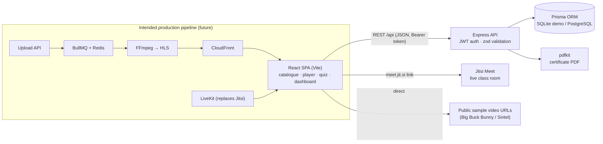

# MiniLearn — a mini LMS

A stripped-down online school built for the "4-hour mini LMS" brief: instructors publish courses and lessons, students enrol, watch, track progress, take an auto-graded quiz and download a PDF certificate. Instructors get a Chart.js dashboard of enrolments and earnings.

## Stack

| Layer | Choice |
|---|---|
| Frontend | React 18 + TypeScript + Vite, React Router, Chart.js (`react-chartjs-2`) |
| Backend | Node.js + Express 4 + TypeScript |
| Database | Prisma ORM + SQLite (the schema maps 1:1 to PostgreSQL) |
| Auth | JWT (`jsonwebtoken`) + `bcryptjs`, student / instructor roles |
| PDF | `pdfkit` |
| Validation | `zod` |
| Live class | Jitsi Meet room link (`https://meet.jit.si/minilearn-<courseId>`) |

> **Note on the database:** the brief asks for Dockerised PostgreSQL. Docker is installed on this machine but has no running daemon/desktop, so the app ships with SQLite for a zero-setup demo. Everything else (Prisma, relations, seeding, queries) is unchanged; to switch to Postgres, set `provider = "postgresql"` in `server/prisma/schema.prisma` and point `DATABASE_URL` at a Postgres instance.

## Setup

Requires Node 18+.

```bash
npm install        # installs both workspaces
npm run db:push    # create the SQLite schema
npm run db:seed    # seed demo users, courses, quizzes and progress
npm run dev        # API on :4000, web app on :5173
```

Open http://localhost:5173. `npm run setup` does install + schema + seed in one go.

Production-style run:

```bash
npm run build      # tsc for the server, tsc + vite build for the client
npm start          # serve the API build
```

The client talks to the API through a Vite dev proxy (`/api` → `http://localhost:4000`), so no CORS setup is needed in development.

### Demo accounts

| Role | Email | Password |
|---|---|---|
| Instructor (also admin flag) | `instructor@minilearn.dev` | `teach123` |
| Platform admin (no UI) | `admin@minilearn.dev` | `admin123` |
| Student | `student@minilearn.dev` | `learn123` |
| Student | `mira@minilearn.dev` | `learn123` |

The student account starts enrolled in two courses with partial progress, so the dashboard and progress bars are populated immediately.

## Features

- **Roles** — students enrol and learn; instructors create and manage their own courses. `isAdmin` is a seeded flag (no admin UI) that can manage any course.
- **Courses & lessons** — instructor creates a course (title, description, price, optional live-class time) and adds video lessons from public URLs; no upload pipeline.
- **Enrolment** — mock checkout (`DEMO-PAY-…` reference), one enrolment per student per course.
- **Progress** — per-lesson completion, progress bar and percentage per enrolment.
- **Quiz** — one MCQ quiz per course, answers graded server-side, best attempt stored; correct answers are only returned after submission.
- **Certificate** — a landscape A4 PDF from `pdfkit`, unlocked at 100% lesson completion plus a passing quiz score.
- **Instructor dashboard** — Chart.js mixed chart: enrolments as bars, earnings (enrolments × price) as a line on a second axis, plus totals and a course list.
- **Live classes** — scheduled time shown with a Jitsi room link.

## API

All routes are prefixed with `/api`. Protected routes expect `Authorization: Bearer <token>`.

| Method | Path | Auth | Purpose |
|---|---|---|---|
| GET | `/api/health` | — | Service check |
| POST | `/api/auth/register` | — | Create student or instructor account |
| POST | `/api/auth/login` | — | Sign in, returns JWT + user |
| GET | `/api/auth/me` | user | Current user |
| GET | `/api/courses` | optional | Course catalogue with lesson/enrolment counts and quiz meta |
| GET | `/api/courses/:id` | optional | Course detail, lessons and viewer state (enrolment, completions, progress, best attempt) |
| POST | `/api/courses` | instructor | Create a course |
| POST | `/api/courses/:id/lessons` | instructor (owner/admin) | Add a lesson |
| POST | `/api/courses/:id/quiz` | instructor (owner/admin) | Create/replace the course quiz |
| POST | `/api/courses/:id/enroll` | student | Enrol with a mock payment reference |
| GET | `/api/my/enrollments` | user | Enrolled courses with progress and next lesson |
| POST | `/api/enrollments/:enrollmentId/lessons/:lessonId/complete` | student | Mark a lesson complete (idempotent) |
| GET | `/api/courses/:id/quiz` | enrolled / manager | Quiz questions without correct answers, plus best attempt |
| POST | `/api/courses/:id/quiz/submit` | enrolled student | Auto-grade answers, save attempt, return per-question feedback |
| GET | `/api/courses/:id/certificate` | eligible student | Download the PDF certificate |
| GET | `/api/instructor/dashboard` | instructor | Per-course enrolments/earnings and totals |

## Architecture



The heavy brief milestones are intentionally stubbed at demo level: pre-made video links instead of upload/transcode, direct URLs instead of CloudFront, Jitsi instead of LiveKit, and a mock payment step.

## Project structure

```
.
├── client/                   # React + Vite app
│   └── src/
│       ├── pages/            # Courses, CourseDetail, MyLearning, Dashboard, Login
│       ├── components/       # Nav, ProgressBar, QuizPanel, InstructorTools
│       ├── api.ts            # typed fetch wrapper + certificate download
│       ├── auth.tsx          # session context, login/register/logout
│       └── styles.css
├── server/                   # Express + Prisma API
│   ├── prisma/schema.prisma  # User, Course, Lesson, Enrollment, Completion, Quiz, Question, Attempt
│   ├── prisma/seed.ts        # demo users/courses/quizzes/progress
│   └── src/
│       ├── auth.ts           # JWT signing + middleware
│       ├── progress.ts       # shared completion/eligibility calculation
│       └── routes/           # auth, courses, enrollments, quiz, instructor
├── lms-mini-project/         # original brief notes
└── package.json              # npm workspaces + dev/build scripts
```

## Data model

`User 1—N Course` (instructor) · `Course 1—N Lesson` · `User N—M Course` via `Enrollment` · `Enrollment 1—N LessonCompletion` · `Course 1—1 Quiz 1—N Question` · `User 1—N QuizAttempt`.

Progress = completed lessons ÷ total lessons. Certificate requires 100% and at least one passing attempt (score ≥ the quiz pass mark).

## Submission checklist status

- [x] Working app with role-based login, enrolment, progress, quiz, certificate and dashboard
- [x] README with setup, API table and Mermaid architecture diagram
- [x] Seed script and demo data
- [ ] Screen recording / presentation — to be recorded by the author
- [ ] Automated Postman/Jest tests — current verification is manual end-to-end through the UI and API
- [ ] Dockerised PostgreSQL — SQLite used locally (see note above)
